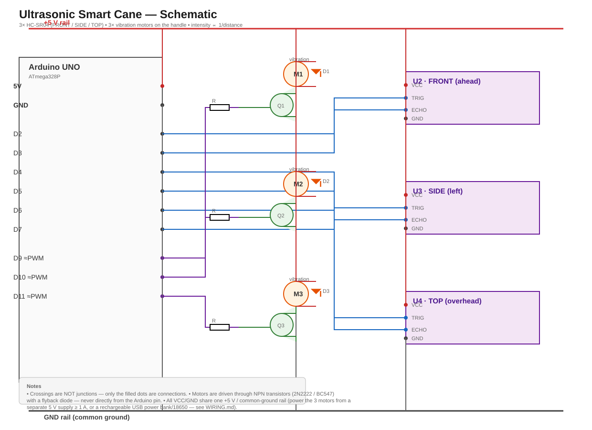
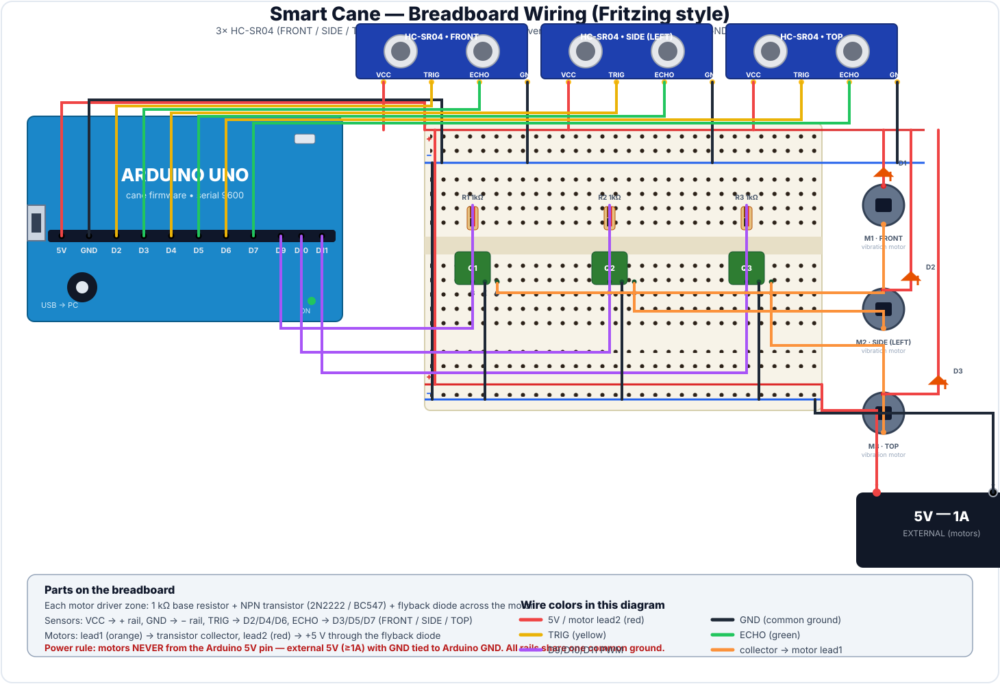

# Smart Cane — Ultrasonic Obstacle-Detection Cane for the Visually Impaired

A wearable **smart cane** built on an Arduino UNO. Three HC-SR04 ultrasonic sensors
scan **three directions** — front, side, and overhead — and each one drives its own
vibration motor on the handle. When an object is detected, the handle vibrates on
the corresponding side, and the vibration gets **stronger the closer the object is**.
The user "feels" both the direction and the proximity of an obstacle without any
visual or audio attention.




---

## Features

- **3 directional ultrasonic sensors**: FRONT (ahead), SIDE (left), TOP (overhead /
  low objects). Each maps to a dedicated motor on the handle.
- **Proximity-encoded vibration**: motor strength is proportional to `1/distance` —
  a close object buzzes hard, a far one vibrates gently (configurable).
- **Robust ranging**: 3-sample median filter per sensor, so a single spurious echo
  never jumps the reading.
- **Full PWM drive**: motors are driven through NPN transistors with flyback diodes —
  safe for the Arduino pins.
- **Live serial readout**: prints every direction's distance + motor level @ 9600
  baud (great for demos and tuning).
- **Clean PlatformIO project** — build and flash with one command.

## Hardware

| Qty | Part | Notes |
|----:|------|-------|
| 1 | Arduino UNO (ATmega328P) | any UNO-compatible board |
| 3 | HC-SR04 ultrasonic sensor | one each for front / side / top |
| 3 | Vibration motor (coin / pancake 3–5 V) | mounted on the handle |
| 3 | NPN transistor (2N2222 / BC547) | motor driver |
| 3 | 1 kΩ resistor | base resistor |
| 3 | 1N4007 / 1N4148 diode | flyback across each motor |
| 1 | 5 V supply, ≥ 1 A (external) | for the 3 motors — NOT the Arduino 5V pin |
| 1 | Breadboard + jumper wires | |

## Wiring

Full point-to-point list: **[WIRING.md](WIRING.md)** — with a schematic at
[`schematic/smart_cane_schematic.svg`](schematic/smart_cane_schematic.svg) and a
Fritzing-style breadboard layout at
[`schematic/smart_cane_breadboard.svg`](schematic/smart_cane_breadboard.svg).

| Arduino pin | Connects to |
|---|---|
| D2 / D4 / D6 | HC-SR04 **TRIG** (FRONT / SIDE / TOP) |
| D3 / D5 / D7 | HC-SR04 **ECHO** (FRONT / SIDE / TOP) |
| D9 / D10 / D11 | Transistor base via 1 kΩ (motor M1 / M2 / M3) |
| 5V | 3× sensor VCC |
| GND | Common ground (Arduino + sensors + transistor emitters + PSU −) |
| External 5V | 3× motor V+ (through flyback diode) |

> ⚠️ Power the motors from the **external 5 V supply**, never the Arduino 5V pin.
> Tie the supply's GND to the Arduino GND (common ground). See WIRING.md.

## Build & flash (PlatformIO)

```bash
cd "the stick"
pio run                 # build
pio run -t upload       # flash to the Arduino UNO
pio device monitor       # live distance/motor readout @ 9600 baud
```

## How it works

1. On every loop, each sensor is read **3×** and the **median** is kept
   (a single spurious echo is discarded).
2. Distance in cm is `duration × 0.017` (round-trip sound timing).
3. `intensityFromCm()` maps distance → motor PWM:
   - no echo / beyond `FAR_CM` (200 cm) → motor **off**,
   - ≤ `NEAR_CM` (15 cm) → **full** vibration (255),
   - in between → linear `1/distance` ramp.
4. That PWM value goes to the matching motor (`analogWrite` on D9/D10/D11).
5. Serial prints e.g. `FRONT: 42.3cm  motor=188`.

## Tuning

| Constant | Default | Meaning |
|---|---:|---|
| `SAMPLE_COUNT` | 3 | readings per sensor (median) |
| `NEAR_CM` | 15 | distance for 100% vibration |
| `FAR_CM` | 200 | beyond this the motor is off |
| `SENSOR_GAP_MS` | 30 | pause between sensors (avoid echo cross-talk) |

Change the thresholds to taste (e.g. tightening `FAR_CM` to 120 m makes the cane
more sensitive near the body but less "chatty" about distant walls).

## Roadmap / v2 ideas

- **Audio + haptic combo**: add a buzzer for hazards (and a vibration code for
  "stairs up / stairs down").
- **On/off + battery monitor** and deep-sleep idle to extend runtime on one 18650.
- **A single rotating servo-mounted sensor** (like the radar project) to cut cost,
  at the price of slower response.
- **Inertial compensation**: ignore vibration when the cane is being shaken in
  the user's hand.
- **Phone link** (ESP32 variant): GPS + "obstacle log" for review.

## License

MIT — see LICENSE.
